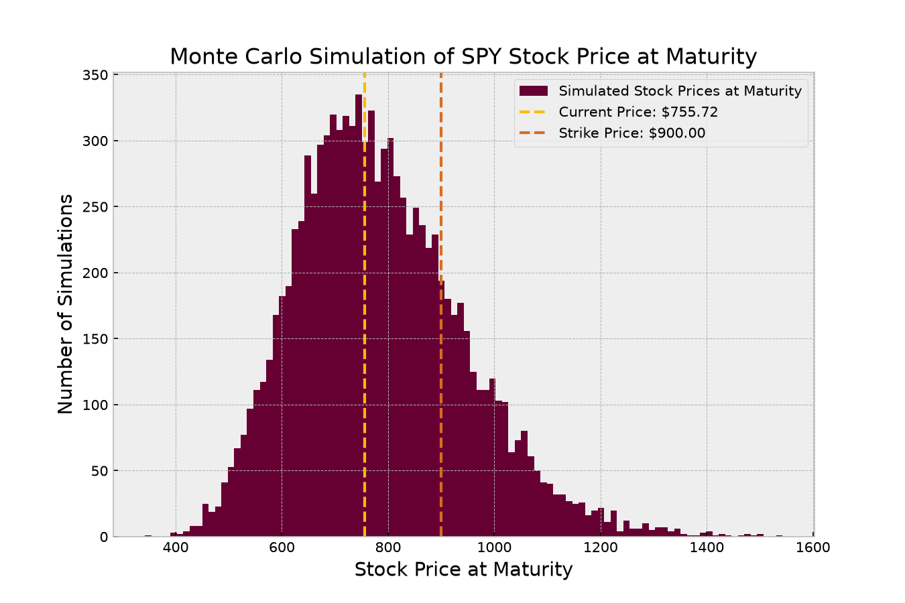

# Black-Scholes & Monte Carlo Option Pricing

Python script for pricing European **Call** and **Put** options on any stock ticker using the **Black-Scholes** formula and **Monte Carlo** simulation.

## What's inside
- `main.py` – takes user input (ticker, strike price, time to maturity), fetches historical prices and the current US Treasury rate (`^IRX`) via `yfinance`, and runs both pricing models
- `methods.py` – Black-Scholes formula and Monte Carlo simulation (Geometric Brownian Motion)
- `plots.py` – histogram of simulated stock prices at maturity ($S_T$) with current and strike price levels

